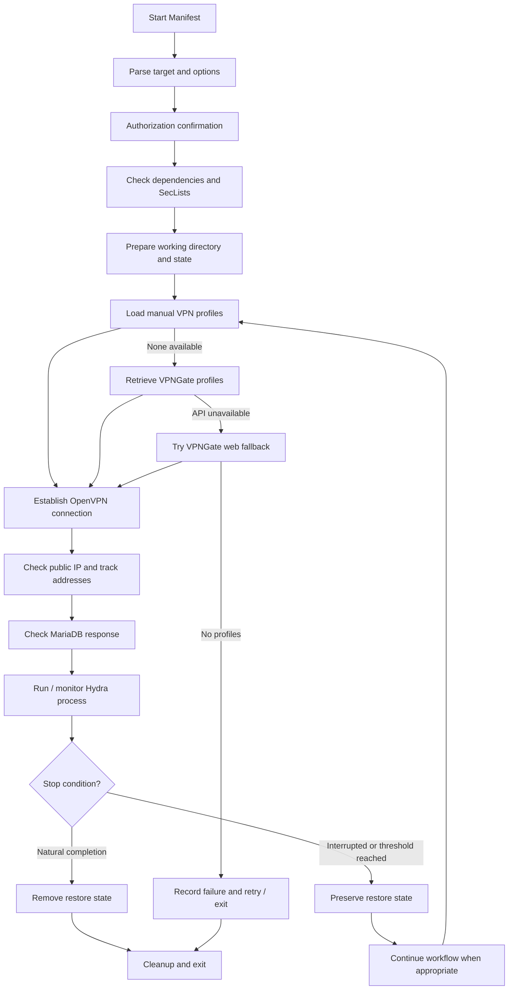

# Manifest — VPN Orchestration & Hydra Session Management

> **Experimental security-research project. Authorized lab use only.**
>
> Manifest automates MariaDB authentication testing with Hydra while managing OpenVPN connections and Hydra restore state. Because the implementation combines automated password guessing with VPN endpoint rotation, it can undermine source-IP-based protections if misused. Use it only in an isolated lab or against a system covered by explicit written authorization and a clearly defined Rules of Engagement (RoE). Do not use it to bypass protections on third-party systems.

## Overview

Manifest is a Bash automation script (the file is currently named `manifest.py`, but its contents use Bash syntax). It coordinates several command-line tools to perform a controlled MariaDB authentication-resilience assessment.

The project focuses on workflow orchestration and recovery:

- Checks required local tools and SecLists wordlists.
- Retrieves OpenVPN profiles from VPNGate, with a web-page fallback, or loads profiles placed in a local manual directory.
- Establishes an OpenVPN connection and checks the resulting public IPv4 address.
- Records observed VPN exit addresses and profile endpoint addresses.
- Performs MariaDB connectivity / response checks before starting the Hydra process.
- Monitors Hydra output, attempt counts, connection-block messages, and stalled sessions.
- Preserves Hydra's restore file when a run is interrupted by the script's configured stop conditions.

**Important:** VPN rotation is not a security boundary and does not make testing anonymous. Public VPN endpoints may be unreliable, shared, logged, or blocked. The tool does not guarantee that an address change will occur.

## STAR — Project Context

### Situation

During an authorized MariaDB authentication-resilience assessment, the target service applied source-address-based blocking after repeated connection errors. VPN connectivity was also inconsistent, and an interrupted Hydra process could require manual recovery.

### Task

Build a Bash-based workflow to coordinate network connectivity checks, VPN profile handling, controlled authentication testing, and recovery of interrupted Hydra sessions—while keeping the assessment within its approved scope.

### Action

- **Orchestrated system tools:** Integrated Bash, OpenVPN, Hydra, the MariaDB client, and standard Linux utilities.
- **Managed VPN profiles:** Added VPNGate API retrieval, a web-page fallback, and support for manually supplied `.ovpn` profiles.
- **Checked connectivity:** Queried public-IP services after connection attempts and checked whether the configured MariaDB endpoint responded.
- **Tracked addresses:** Recorded observed VPN exit addresses and profile endpoint addresses in a local state file.
- **Added execution controls:** Defined an attempt budget, wait interval, stall timeout, and maximum number of profiles per batch.
- **Handled interruptions:** Used Hydra's native restore mechanism to retain recoverable session state when the script stopped a run.
- **Added operational safeguards:** Included an authorization prompt, dependency checks, logging, and cleanup handling.

### Result

The implementation brings VPN profile handling, connectivity checks, process monitoring, and Hydra session recovery into one Bash workflow. It reduces the amount of manual coordination required during a controlled lab assessment and provides local state that helps diagnose interrupted runs.

The project demonstrates practical experience with Linux process management, shell scripting, network troubleshooting, service-response analysis, and automation reliability.

### Takeaway

The main engineering challenge was not simply launching a testing utility; it was coordinating several external processes and handling unreliable network conditions without unnecessarily losing recoverable session state. In a real assessment, source-IP blocking should be evaluated as one layer of defense—not treated as a substitute for strong authentication, network segmentation, account-level controls, and monitoring.

## Architecture & Workflow

The diagram is a high-level representation of the current script. Exact behavior depends on network responses, available profiles, and process exit conditions.

## Requirements

The script checks for these commands:

| Dependency | Purpose |
|---|---|
| Bash | Main scripting environment |
| `hydra` | Authentication-testing engine |
| `mysql` | MariaDB/MySQL connectivity checks |
| `openvpn` | VPN connection management |
| `curl` | API, web, and public-IP requests |
| `base64`, `awk`, `grep`, `sed`, `tail`, `shuf` | Parsing and process monitoring |
| `timeout`, `getent`, `id`, `sudo` | Connectivity limits and environment handling |
| SecLists | Username and password wordlists |

Install dependencies using your Linux distribution's trusted package repositories. SecLists must be available in one of the locations searched by the script:

- `~/Desktop/SecLists`
- `~/Desktop/seclists`
- `~/Desktop/SecLists-master`
- `/usr/share/seclists`

The script selects known wordlist filenames from the SecLists directory. If the expected files are absent, it exits.

## Configuration & Runtime Behavior

The current script accepts these arguments:

| Argument | Description |
|---|---|
| `-t`, `--target` | MariaDB host or IP address; required |
| `-p`, `--port` | MariaDB port; defaults to `3306` |
| `--fresh` | Removes the saved Hydra restore state before starting |
| `-h`, `--help` | Displays the built-in usage information |

The script requests an authorization confirmation unless `I_AM_AUTHORIZED=1` is present in the environment. This prompt is only a reminder; it is **not** a technical authorization check and does not restrict the target to an approved allowlist.

### Built-in working paths

The script creates its working directory under:

`~/Desktop/rotate`

It uses this directory for VPN profiles, logs, restore state, and IP tracking. The `manual` subdirectory is used for manually supplied OpenVPN profiles.

### Current internal limits

| Setting | Current value | Purpose |
|---|---:|---|
| `ATTEMPT_BUDGET` | `10` | Stops a Hydra run after the configured attempt count |
| `WAIT_BETWEEN` | `3` seconds | Hydra wait interval |
| `RESTART_MAX` | `15` | Maximum profiles fetched in a batch |
| `STALL_SECS` | `60` seconds | No-attempt stall threshold |
| `MAX_BATCHES` | `0` | `0` means the outer batch loop has no configured batch limit |

These are implementation values, not a recommendation for testing against production systems. Keep assessments low-impact and use test accounts and a lab service.

## Safe Lab Use

Before running the script:

1. Use a disposable, isolated MariaDB instance and dedicated test accounts.
2. Confirm written authorization, target ownership, allowed source networks, testing window, and stop conditions.
3. Review the script and its dependencies; do not assume the authorization prompt enforces scope.
4. Use only test credentials and non-sensitive wordlists.
5. Confirm that the database, VPN endpoints, and network paths are all within the approved test plan.
6. Monitor the database and stop the assessment if service stability is affected.
7. Protect logs and restore files, and remove test data after the assessment.

The current implementation does **not** provide a dry-run mode or a built-in target allowlist. Those should be added before the tool is used in any environment where scope enforcement must be technically guaranteed. A safer next iteration would also default to fixed, explicitly approved VPN endpoints rather than public endpoint rotation.

## Logs & State

The script stores operational data in `~/Desktop/rotate`, including:

| File / directory | Purpose |
|---|---|
| `hydra.log` | Hydra output |
| `hydra.restore` | Hydra session recovery state |
| `seen_ips.txt` | Previously observed public / endpoint addresses |
| `vpn.log` | OpenVPN connection log |
| `manual/` | Manually supplied `.ovpn` profiles |
| `ovpn/` | Working VPN profile directory |

Treat these files as potentially sensitive. In particular, review logs before sharing them; they may contain target details or authentication-test output.

## Limitations & Future Improvements

- VPNGate availability, profile quality, and connection speed are outside the project's control.
- A changed public IP does not prove that the target is reachable or that a test is authorized.
- The current authorization prompt is user confirmation only; it is not scope enforcement.
- The script relies on specific SecLists paths and filenames.
- The working directory is fixed under the user's Desktop.
- The script is Bash despite its `.py` filename; renaming it to `manifest.sh` would make its purpose clearer.
- The current implementation should be reviewed for process cleanup, TLS verification, secret handling, and restore-file lifecycle.

Potential improvements:

- Add a strict target allowlist and an explicit lab/scope configuration file.
- Add a dry-run mode that validates configuration without starting authentication attempts.
- Replace public VPN rotation with approved, fixed test endpoints.
- Add structured logs and a final machine-readable report.
- Validate command-line arguments and dependency versions more strictly.
- Add automated tests using mocked command outputs and a local disposable database.

## Technology Stack

| Technology | Role |
|---|---|
| Bash | Workflow orchestration |
| Hydra | Authentication-testing process |
| OpenVPN | VPN connection management |
| VPNGate | Public VPN profile source |
| MariaDB / MySQL client | Database connectivity checks |
| SecLists | Test wordlists |
| cURL and GNU/Linux utilities | HTTP requests, parsing, monitoring, and process control |

## Disclaimer

This project is provided for educational purposes and authorized security assessments only. Do not use it against systems, accounts, or networks without explicit permission. You are responsible for complying with applicable laws, contractual obligations, and the assessment's Rules of Engagement.

## License

No license file was present in the supplied project archive. Add a license before granting others permission to use, modify, or redistribute this project.

## Author

Developed as a cybersecurity research project focused on Bash automation, VPN process orchestration, MariaDB authentication behavior, and recoverable security-testing workflows.
